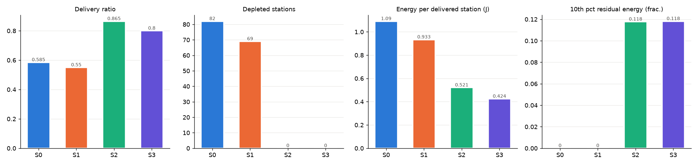
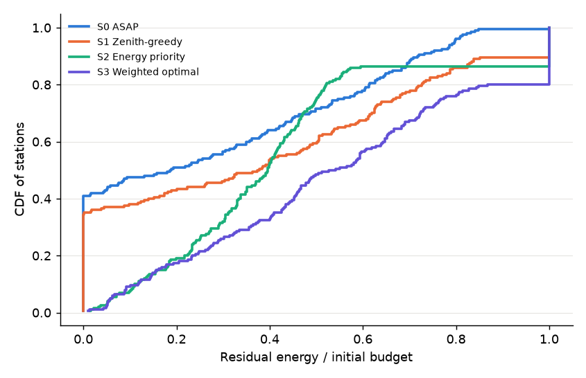

# UC01 Phase A: results (first run)

Run with `bash phase_a/run_all.sh` (seed 42, default parameters from `uc01_model.py`). All 19 tests in `test_uc01.py` pass.

## Files

Shared (uc01 root, Phase B will reuse them):

| File | Purpose |
|------|---------|
| `uc01_model.py` | Parameters, slant range, Friis uplink energy per slot, baseline link-budget check, WGS72 geometry |
| `gen_scenario.py` | Uses Hypatia `satgen` to create 1 satellite (600 km, 14.89 rev/day), N stations, random energy budgets, and per-second distance/elevation |
| `schedulers.py` | S0 ASAP, S1 Zenith-greedy, S2 Energy priority (proposed), S3 Weighted optimal (Hungarian) |
| `run_schedulers.py` | Runs the schedulers → `schedule_<name>.csv` (Phase B will feed this file to ns-3) |

Phase A only (`phase_a/`):

| File | Purpose |
|------|---------|
| `evaluate.py` | Metrics → `summary.csv`, `per_station.csv`, figures `fig_*.png` |
| `test_uc01.py` | Physics, geometry, scheduler-constraint and comparison tests |
| `run_all.sh` | Whole pipeline, both scenarios + tests |
| `results/`, `results_dense/` | Outputs of the two scenarios |

## Model actually used

- Slot = 1 s, rate 1 kbps, so a station with B bits needs ⌈B/1000⌉ slots (1–10). One station per slot (K=1).
- Slot energy = (P_tx / 0.3 + 1 mW) × 1 s, with P_tx = −120 dBm + 10 dB margin + FSPL − 36 dBi. Slots needing more than 23 dBm are unusable.
  → 10° elevation costs **9.6×** the zenith slot.
- Budget_i = U(0.1, 1) × (energy to send all data at 10°). So the poorest stations can only afford high-elevation slots.
- A station that transmits beyond its budget is **depleted**: data lost, energy gone.

## Scenario 1: sparse (100 random stations, ±50° lat, 24 h)

| | delivered | depleted | J / delivered | 10th pct residual | mean Tx elev |
|--|--:|--:|--:|--:|--:|
| S0 ASAP | 2 | 98 | 65.4 | 0.00 | 10.7° |
| S1 Zenith-greedy | 99 | 1 | 0.182 | 0.30 | 68.0° |
| S2 Energy priority | 99 | 0 | 0.178 | 0.30 | 68.3° |
| S3 Weighted optimal | 99 | 0 | 0.178 | 0.30 | 68.3° |

With few stations there is almost no contention, so choosing the **time** of transmission
already does the work (×360 less energy per delivered station than ASAP). Priority = optimal.
One station cannot be served by anyone. Its best pass is too low for its budget. This is
a coverage limit, not a scheduling one.

## Scenario 2: dense (200 stations in a 6°×6° box at 45N 10E, 6 h)

| | delivered | depleted | J / delivered | 10th pct residual | mean Tx elev |
|--|--:|--:|--:|--:|--:|
| S0 ASAP | 117 | 82 | 1.09 | 0.00 | 27.0° |
| S1 Zenith-greedy | 110 | 69 | 0.93 | 0.00 | 29.7° |
| **S2 Energy priority** | **173** | **0** | 0.52 | 0.12 | 32.6° |
| S3 Weighted optimal | 160 | 0 | **0.42** | 0.12 | 35.4° |

Here every station wants the same few high-elevation seconds:
- **Zenith-greedy is worse than ASAP** for delivery. The first stations take the peak and the
  late (often poor) ones are left with expensive slots and run out of energy. Selfish
  optimisation hurts the weak stations, which is exactly the problem from the use case.
- **Energy priority** gives the cheap slots to the poor stations first: no depletion, +56 % delivered vs ASAP, half the energy per delivered station.
- **Weighted optimal** has the lowest energy per delivered station but delivers fewer. It
  minimises the *sum* of budget fractions, and the assignment cannot enforce a per-station
  budget (sum of slots ≤ budget). Over-budget stations are dropped afterwards. So S3 is an
  energy-efficiency reference, not a delivery upper bound.
- Rich stations pay with latency (S2 mean latency 3771 s vs 3290–3367 s). That is the intended trade-off.

Figures: `results_dense/fig_summary_bars.png`, `fig_residual_cdf.png`, `fig_budget_vs_elevation.png`.




## Raw console output (`bash phase_a/run_all.sh`)

Column meaning: `delivered`/`depleted` = station counts, `total_energy_j` = sum of energy spent,
`energy_per_del` = J per delivered station, `min_residual_f` / `p10_residual_f` = min / 10th percentile of
(remaining energy / budget), `jain_residual` = Jain fairness of that ratio, `mean_tx_elev_d` = mean
elevation at transmission (deg), `mean_latency_s` = last Tx slot minus first visibility (s).

```
Satellite: 600 km, 14.89 rev/day, incl 53.0 deg
Stations: 100, with at least one pass: 100
Visible (station, step) samples: 170959 -> gen/
asap      scheduled 100 stations in 0.1s
zenith    scheduled 100 stations in 0.1s
priority  scheduled  99 stations in 0.1s
optimal   scheduled  99 stations in 2.3s
               delivered       depleted total_energy_j energy_per_del min_residual_f p10_residual_f  jain_residual mean_tx_elev_d mean_latency_s
asap                   2             98          130.8          65.38              0              0        0.01877          10.66           10.5
zenith                99              1          18.05         0.1823              0         0.2957          0.903          67.99      3.052e+04
priority              99              0          17.63         0.1781        0.09768         0.2985         0.9116          68.34      3.052e+04
optimal               99              0          17.63         0.1781        0.09768         0.2985         0.9116          68.34      3.052e+04
Satellite: 600 km, 14.89 rev/day, incl 53.0 deg
Stations: 200, with at least one pass: 200
Visible (station, step) samples: 204104 -> gen_dense/
asap      scheduled 199 stations in 0.1s
zenith    scheduled 179 stations in 0.1s
priority  scheduled 173 stations in 0.1s
optimal   scheduled 160 stations in 2.8s
               delivered       depleted total_energy_j energy_per_del min_residual_f p10_residual_f  jain_residual mean_tx_elev_d mean_latency_s
asap                 117             82          127.7          1.091              0              0         0.4697          27.01           3367
zenith               110             69          102.7         0.9334              0              0         0.5297          29.68           3309
priority             173              0          90.11         0.5209        0.01404         0.1177         0.7154          32.61           3771
optimal              160              0          67.88         0.4243       0.009623         0.1182         0.7586          35.44           3290
...................                                                                                                                                    [100%]
19 passed in 10.84s
```

## Limits / next steps

1. Make S3 budget-aware (ILP with per-station energy constraint, e.g. `scipy.optimize.milp`). That gives a true optimum for delivery.
2. Sweeps from `02_test_design_and_analysis.md` §8 (N, K via `--capacity`, energy spread, ε_min).
3. Contiguous transmission slots (now a station may split data over several seconds or even passes).
4. Energy harvesting between passes.
5. Phase B (ns-3, `../phase_b/`) only after the schedule model is settled.
